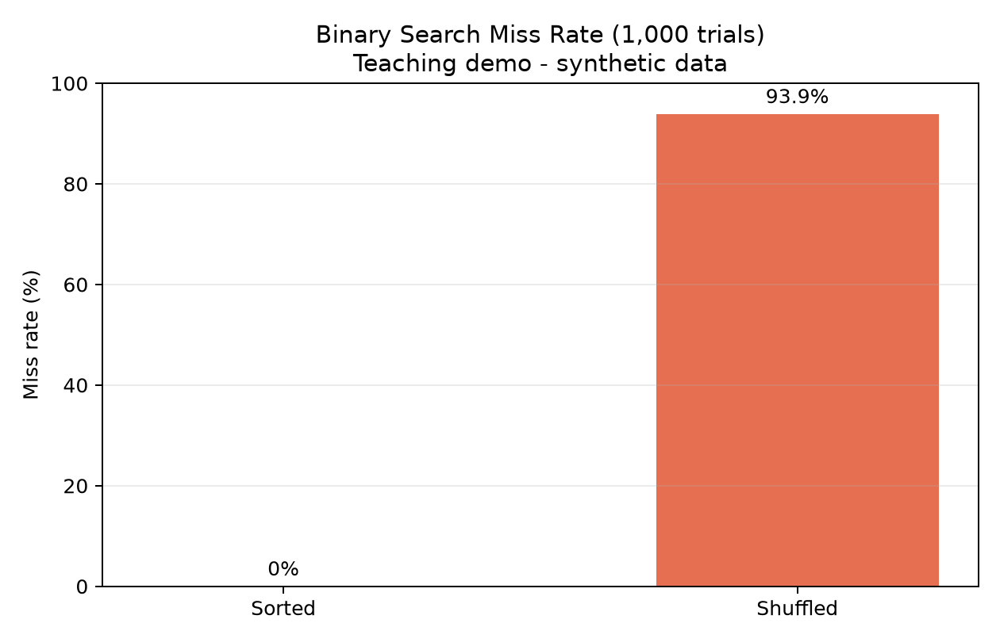
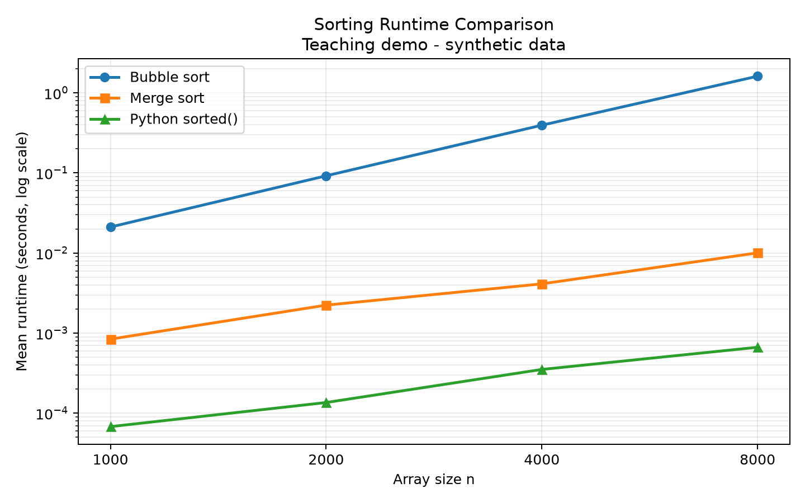

# HW1 算法实验报告：排序与二分查找

- 课程：《人工智能程序设计与实践》2026 秋
- 实验主题：归并排序、二分查找与排序性能对照
- 独立仓库：`hw1-algo`
- 数据声明：**本报告使用的随机整数、模拟利率、月供及实验结果均为“教学演示虚构数据”，仅用于算法教学，不构成任何金融建议。**

## 一、问题与目标

本实验面向需要处理大量数值数据和有序利率表的程序设计学习者及业务开发人员，解决三个问题：自造排序算法随数据规模增长是否高效、二分查找为什么必须依赖有序数据、Python 内置排序与自造算法有多大性能差距。

具体目标如下：

1. 实现归并排序，用 `n=8000` 的递归深度和调用次数验证分治过程。
2. 实现递归二分查找，在 1024 档模拟利率表中查找 3.75%，并在 100 档模拟利率表中寻找月供最接近 5000 元的利率。
3. 通过有序与乱序对照实验检验二分查找的前置条件，用漏报率量化乱序风险。
4. 对冒泡排序、归并排序和 Python `sorted()` 进行计时，验证 `O(n²)`、`O(n log n)` 的增长规律及实际性能差异。

## 二、方法与过程

### 2.1 数据

| 数据类别 | 规模与范围 | 生成方式 | 用途 |
|---|---|---|---|
| 随机整数数组 | `n=1000/2000/4000/8000`，整数范围 0～100000 | 固定随机种子 42，每档生成一份 | 排序正确性与性能测试 |
| 递归观察数组 | 8000 个随机整数 | 固定随机种子 42 | 观察归并排序递归树 |
| 1024 档模拟利率表 | 0.01%～10.24%，步长 0.01% | 等差生成并保留两位小数 | 精确查找与未命中测试 |
| 100 档模拟利率表 | 3.00%～5.97%，步长 0.03% | 等差生成并保留两位小数 | 月供最近值查找 |
| 模拟贷款参数 | 本金 1000000 元，期限 360 个月 | 等额本息公式计算月供 | 构造单调月供数组 |
| 乱序实验数组 | 1～100，每次随机打乱，共 1000 轮 | 固定随机种子 42，目标值 50 | 统计二分查找漏报率 |

### 2.2 预处理

1. **排序实验：** 每个规模只生成一份原始数组；冒泡排序在副本上原地交换，归并排序返回新数组，避免不同算法相互污染输入。
2. **查找实验：** 二分查找前将数据按升序排列；利率生成时执行两位小数舍入，比较时使用 `1e-9` 容差，降低浮点误差影响。
3. **月供实验：** 将利率映射为月供。月供随利率单调递增，因此可对月供数组执行最近值二分查找。
4. **乱序实验：** 对相同元素分别保留有序和乱序两个版本；随机乱序组与排序对照组使用相同目标和试验次数。
5. **性能实验：** 使用 `timeit.repeat(..., repeat=3, number=1)`，每档运行 3 次并取算术平均值；同时用 `assert merge_sort(arr) == sorted(arr)` 检查结果正确性。

关键预处理代码如下，完整实现见 `binary_search.py` 和 `benchmark.py`：

```python
random.seed(42)
data = [random.randint(0, 100000) for _ in range(n)]

rates_1024 = [round(0.01 + i * 0.01, 2) for i in range(1024)]
rates_100 = [round(3.00 + i * 0.03, 2) for i in range(100)]
payments = [
    round(monthly_payment(1_000_000, rate, 360), 2)
    for rate in rates_100
]
```

### 2.3 建模

#### （1）归并排序

归并排序采用“分解—递归解决—合并”的分治过程：数组不断从中间拆分，长度不超过 1 时返回；两个有序子数组通过双指针按值合并。其时间复杂度为 `O(n log n)`，辅助空间复杂度为 `O(n)`，递归深度为 `O(log n)`。

```python
def merge_sort(nums):
    if len(nums) <= 1:
        return nums
    mid = len(nums) // 2
    left = merge_sort(nums[:mid])
    right = merge_sort(nums[mid:])
    return merge(left, right)

def merge(a, b):
    result, i, j = [], 0, 0
    while i < len(a) and j < len(b):
        if a[i] <= b[j]:
            result.append(a[i])
            i += 1
        else:
            result.append(b[j])
            j += 1
    result.extend(a[i:])
    result.extend(b[j:])
    return result
```

#### （2）二分查找与最近值查找

二分查找每次检查当前区间中点，根据比较结果保留左半或右半区间。实现每次只递归一个子问题，子问题答案直接返回，无额外合并步骤；时间复杂度为 `O(log n)`，递归栈空间为 `O(log n)`。**前置条件是数组有序；最近值变体还要求目标映射具有单调性。**

```python
def binary_search(rates, target, low=0, high=None):
    if high is None:
        high = len(rates) - 1
    if low > high:
        return -1

    mid = low + (high - low) // 2
    if abs(rates[mid] - target) < 1e-9:
        return mid
    if rates[mid] < target:
        return binary_search(rates, target, mid + 1, high)
    return binary_search(rates, target, low, mid - 1)
```

月供采用等额本息公式 `M = P × r × (1+r)^n / ((1+r)^n − 1)`，其中 `P` 为本金、`r` 为月利率、`n` 为期数；当 `r=0` 时，`M=P/n`。最近值查找在区间耗尽后比较左右边界，返回与 5000 元差值较小的候选。

#### （3）性能对照模型

冒泡排序通过相邻元素反复交换完成排序，时间复杂度为 `O(n²)`；归并排序为 `O(n log n)`；Python `sorted()` 使用高度优化的 Timsort。理论预期是：`n` 翻倍时，冒泡耗时约变为 4 倍，归并排序和 `sorted()` 在随机数据上的耗时应更接近约 2 倍的增长量级。

```python
def benchmark_sort(arr, sort_func, repeat=3):
    def wrapper():
        sort_func(arr)
    times = timeit.repeat(wrapper, repeat=repeat, number=1)
    return sum(times) / len(times)

assert merge_sort(arr) == sorted(arr)
```

### 2.4 评估

| 评估对象 | 指标与计算方法 | 判定依据 |
|---|---|---|
| 归并排序分治过程 | 最大递归深度、总调用次数、排序结果 | 深度应等于 `ceil(log2(n))`；本实验满递归树调用次数应为 `2n−1`；结果与 `sorted()` 一致 |
| 二分查找正确性 | 返回下标、比较次数、未命中返回值 | 目标存在时返回对应下标，不存在时返回 -1，比较次数呈对数增长 |
| 月供最近值 | 利率、月供、与 5000 元的绝对偏差 | 与遍历全部 100 档所得最优下标一致 |
| 乱序风险 | 漏报率 = 目标存在却返回 -1 的次数 / 总试验次数 | 有序对照组漏报率应为 0%；乱序组用于暴露错误，不以碰巧命中为正确依据 |
| 排序性能 | 3 次平均耗时、耗时增长倍数、冒泡/归并加速比 | 增长趋势符合理论量级；`n=8000` 时归并比冒泡快至少 10 倍 |

复现命令：

```powershell
python merge_sort.py
python binary_search.py
python benchmark.py
```

## 三、结果

> **本节所有表格与图均基于“教学演示虚构数据”。计时结果为 2026-11-17 本次复跑记录，每档 3 次取均值；不同设备和负载下的绝对耗时会有差异。**

### 3.1 归并排序递归与正确性

小样例 `[8, 3, 5, 1, 9, 2]` 排序后得到 `[1, 2, 3, 5, 8, 9]`。`n=8000` 的递归统计如下：

| 指标 | 实测值 | 理论值 | 判定 |
|---|---:|---:|---|
| 最大递归深度（顶层记为 0） | 13 | `ceil(log2(8000))=13` | 符合 |
| 总递归调用次数 | 15999 | `2×8000−1=15999` | 符合 |
| 递归深度增长量级 | 对数级 | `O(log n)` | 符合 |

### 3.2 有序利率与月供查找

| 实验任务 | 结果 | 比较次数 | 独立验证 |
|---|---|---:|---|
| 1024 档利率表查找 3.75% | 下标 374 | 10 | `0.01 + 374×0.01 = 3.75`，结果正确 |
| 1024 档利率表查找不存在的 5.555% | 返回 -1 | 10 | 未命中处理正确 |
| 100 档利率表找月供最接近 5000 元 | 下标 46，利率 4.38%，月供 4995.80 元，偏差 4.20 元 | 7 | 遍历全部候选所得最优下标同为 46 |

### 3.3 未排序翻车实验

| 实验 | 输入与目标 | 输出 | 结论 |
|---|---|---|---|
| 确定性有序对照 | `[1,3,5,7,9]`，找 1 | 下标 0，比较 2 次 | 正确命中 |
| 确定性乱序实验 | `[5,1,9,3,7]`，找 1 | -1，比较 2 次 | 目标存在但漏报 |
| 随机乱序统计 | 1～100 随机打乱，找 50，1000 轮 | 漏报 939 次，漏报率 93.9% | 乱序时结果不可靠 |
| 排序对照组 | 同一批数据排序后查找，1000 轮 | 漏报率 0% | 满足有序前提后结果稳定 |



**图 1　二分查找漏报率对比（教学演示虚构数据）**

原程序“实验 3”把前面已改为 50 的 `target` 继续用于 `[1,3,5,7,9]`，因此返回 -1 是**测试目标变量被覆盖**，不是“排序修复无效”。补充验证时将目标明确重置为 1，排序后的数组返回下标 0、比较 2 次，修复有效；原测试代码仍需修正该变量复用问题。

### 3.4 排序性能对照

| 数组大小 n | 冒泡耗时（秒） | 归并耗时（秒） | sorted 耗时（秒） | 冒泡/归并 | 归并/sorted |
|---:|---:|---:|---:|---:|---:|
| 1000 | 0.021130 | 0.000841 | 0.000068 | 25.12 | 12.3 |
| 2000 | 0.092062 | 0.002235 | 0.000136 | 41.19 | 16.5 |
| 4000 | 0.394528 | 0.004122 | 0.000352 | 95.72 | 11.7 |
| 8000 | 1.613315 | 0.010045 | 0.000666 | 160.61 | 15.1 |



**图 2　三种排序方法运行时间对比，纵轴为对数刻度（教学演示虚构数据）**

| 规模变化 | 冒泡耗时倍数（期望约 4） | 归并耗时倍数（期望约 2） | sorted 耗时倍数（期望约 2） | 判定 |
|---|---:|---:|---:|---|
| 1000 → 2000 | 4.36 | 2.66 | 1.98 | 均在程序设定容差内 |
| 2000 → 4000 | 4.29 | 1.84 | 2.60 | 均在程序设定容差内 |
| 4000 → 8000 | 4.09 | 2.44 | 1.89 | 均在程序设定容差内 |

`n=8000` 时，归并排序比冒泡排序快 160.61 倍，超过“至少 10 倍”的实验要求；内置 `sorted()` 又比自造归并排序快约 15.1 倍，说明教学实现与工程优化实现仍有明显差距。

## 四、结论与建议

大规模业务数据排序应优先使用内置 `sorted()`，避免冒泡排序造成性能瓶颈，自造归并排序主要用于教学与算法验证。  
有序利率表可采用二分查找提高检索效率，上线前必须校验排序和单调性，防止目标漏报。  
月供结果仅为教学演示，实际业务应接入真实利率、费用和贷款规则，并保留人工复核。

## 五、局限与改进

1. **计时代表性有限：** 仅记录单台设备、单组随机种子和每档 3 次计时，未记录 CPU、内存及后台负载，微小计时易受噪声影响。后续应补充环境信息，增加重复次数和规模档位，并报告中位数、标准差及置信区间。
2. **测试覆盖仍需完善：** 当前对空数组、重复值、首尾元素、单元素和最近值同距等情况覆盖不足；乱序实验第 3 段还存在 `target` 变量复用问题。后续应使用局部变量和 `pytest` 参数化测试，并为每次实验显式设置目标、加入断言。
3. **算法与业务均有边界：** 递归二分查找占用 `O(log n)` 栈空间，最近值查找依赖单调映射；模拟利率和月供不代表真实贷款成本。工程应用可改为迭代查找，并接入真实数据、费用规则、精度规范和异常数据校验。

## 六、AI 使用记录（指令 + 验证）

以下按原记录完整列出 AI 指令，并补充本次复跑、断言或人工核对结果；重复出现的指令也予以保留。

### 6.1 merge_sort

| 编号 | AI 指令 | 验证与处理 |
|---|---|---|
| AI-01 | 给你下面这段代码，帮我看看有什么问题，如果有，请指出来，否则请说没有问题，并且请说明问题所在的位置和原因，以及如何修复 | 人工检查基准情形、左右拆分和双指针合并逻辑；运行小样例 `[8,3,5,1,9,2]`，输出 `[1,2,3,5,8,9]`，并在基准程序中用 `sorted()` 做一致性断言。 |
| AI-02 | 给 merge_sort 加”递归深度打印”，观察 8000 元素的递归树深度，是否符合预期？ | 复跑 `merge_sort.py`，实测最大深度 13、调用 15999 次，分别等于 `ceil(log2(8000))` 和 `2n−1`，符合预期。 |

### 6.2 binary_search

| 编号 | AI 指令 | 验证与处理 |
|---|---|---|
| AI-03 | 帮我看看这个代码，有没有问题，为什么运行不出来，指出问题并且给出更改 | 检查 `high` 初始化、空区间终止条件、左右递归边界和浮点容差；运行基础样例，目标 7 返回下标 3，比较 4 次。 |
| AI-04 | 我要实现 binary_search(rates, target)（rates 有序）并且能在 1024 档模拟利率表中找 3.75%，这个你帮我想想办法，怎么在上面代码的基础上实现 | 检查利率表长度 1024、范围 0.01%～10.24%；复跑后 3.75% 返回下标 374、比较 10 次，不存在的 5.555% 返回 -1。 |
| AI-05 | 现在我要确认你给我的代码是真分治 | 阅读递归路径：每轮计算中点并将区间缩小一半，只保留一个子区间，子问题结果直接返回，无线性扫描和额外合并步骤；1024 档查找比较 10 次，与对数级预期一致。 |
| AI-06 | 用二分查找在真实利率表（自制 100 档）找”月供最接近 5000 的利率” 10 | 复跑得到下标 46、利率 4.38%、月供 4995.80 元、偏差 4.20 元；另用 `min(range(...), key=...)` 遍历全部候选，最优下标同为 46。报告统一标注为教学演示虚构数据。 |
| AI-07 | 那现在帮我设计一个（ binary_search.py 6 - 121 ）”未排序翻车”实验 | 固定随机种子 42 复跑 1000 轮，乱序漏报 939 次、漏报率 93.9%，有序对照为 0%；同时发现实验 3 的 `target` 被覆盖为 50，补充重置为 1 后返回下标 0，并将该测试缺陷写入报告。 |

### 6.3 benchmark

| 编号 | AI 指令 | 验证与处理 |
|---|---|---|
| AI-08 | 帮我生成 n=1000/2000/4000/8000 的随机整数数组各一份；分别用"冒泡排序(自己实现)"和"合并排序(Step1的)"计时，用 timeit 每档跑3次取均值；输出对照表：n、冒泡耗时、合并耗时、倍数关系 | 检查数据生成、输入副本、`timeit.repeat(..., repeat=3, number=1)` 和均值计算；复跑得到四档结果，并用 `merge_sort(arr) == sorted(arr)` 验证正确性。 |
| AI-09 | 现在帮我检查一下n 翻倍时，冒泡耗时≈×4，合并耗时≈×2；n=8000 时合并比冒泡快一个数量级以上。如果有错误，可以修改上面的程序 | 本次复跑的三组冒泡增长倍数为 4.36、4.29、4.09，归并为 2.66、1.84、2.44；`n=8000` 时归并比冒泡快 160.61 倍，满足要求。 |
| AI-10 | 输出对照表：n、冒泡耗时、合并耗时、倍数关系 | 将四档平均耗时和加速比整理为 Markdown 表，并据同一组数据绘制性能图，确保表图一致。 |
| AI-11 | 现在帮我检查一下n 翻倍时，冒泡耗时≈×4，合并耗时≈×2；n=8000 时合并比冒泡快一个数量级以上。如果有错误，可以修改上面的程序 | 原记录中该指令重复出现，仍完整保留；再次核对增长表，删除旧报告中的重复行和残片，所有数值均可由本次性能表计算。 |
| AI-12 | 把 benchmark 扩展到 Python 内置 sorted()，对比”轮子 vs 自造” 15 | 复跑内置 `sorted()` 四档计时；`n=8000` 时耗时 0.000666 秒，自造归并为 0.010045 秒，后者约为前者的 15.1 倍。 |
| AI-13 | 帮我看看（ benchmark.py 7 - 165 ）为什么它的运行结果里 Terminal 会出现多行重复 | 检查 `main()` 调用和 `if __name__ == "__main__":` 保护，复跑当前版本时性能表与增长检查均只输出一次；整理报告时删除旧文本的重复粘贴内容，未把旧输出残片当作实验结果。 |

### 6.4 报告整理

| 编号 | AI 指令 | 验证与处理 |
|---|---|---|
| AI-14 | 根据 HW1 要求和 `aip-major-assignment-1.docx` 模板更改 `report.md`，补齐问题与目标、数据→预处理→建模→评估、结果表图、结论与建议、局限与改进、完整 AI 使用记录及作答登记。 | 逐项对照 DOCX 模板；复跑三份程序，交叉检查表格计算与图片数据；明确标注“教学演示虚构数据”，结论控制为 3 行，并保留测试缺陷和局限，未虚构仓库地址。 |


## 七、本题作答区域登记

- **完成情况（问题与方法一句话）：** 围绕随机整数排序和模拟利率检索问题，采用归并排序、二分查找及 `timeit` 对照实验，完成了数据生成、预处理、算法建模和指标评估。
- **结果一句话：** `n=8000` 时归并排序比冒泡排序快 160.61 倍，二分查找在 1024 档有序利率表中比较 10 次命中 3.75%，乱序实验漏报率为 93.9%。
- **AI 使用一句话：** AI 用于代码调试、实验设计、性能核对和报告整理，所有指令及复跑、断言和人工验证结果已在第六节完整记录。
- **独立仓库：** `hw1-algo`；仓库地址：https://github.com/Carren1222/hw1-algo.git（提交前填写，并确保代码、报告、图和 AI 使用记录均已上传）。
